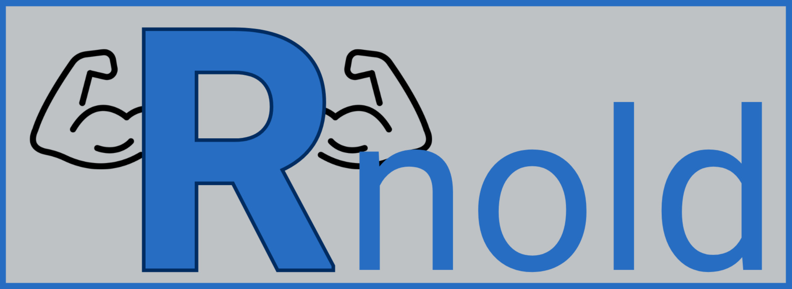

  

 

    
    
    
     
     
    
    
    
    
    
    

 

# Rnold 💪

Rnold is an interactive, browser-based platform for learning [R programming language](https://www.r-project.org/about.html).